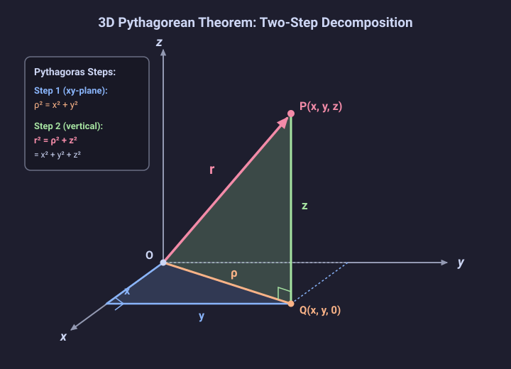

# Problem 1.3

!!! info "Textbook Reference"
    - **Textbook**: *Classical Mechanics* (John R. Taylor)
    - **Chapter**: 1 — Newton's Laws of Motion
    - **Section**: 1.2 — Space and Time
    - **Problem**: 1.3
    - **Difficulty**: $\star$
    - **Topic**: Vector magnitude, 3D Pythagorean theorem

---

## Problem Statement

By applying Pythagoras's theorem (the usual two-dimensional version) twice over, prove that the length $r$ of a three-dimensional vector $\mathbf{r} = (x, y, z)$ satisfies:

$$
r^2 = x^2 + y^2 + z^2
$$

---

## Geometric Representation

---

## Proof

Let $P(x, y, z)$ denote the point in Cartesian three-space whose position vector relative to the origin $O(0, 0, 0)$ is $\mathbf{r} = (x, y, z)$.

Drop a perpendicular from $P$ onto the $xy$-plane, and denote this orthogonal projection as:

$$
Q(x, y, 0)
$$

### Step 1: Projection onto the $xy$-Plane

In the $xy$-plane, consider the right-angled triangle whose vertices are the origin $O(0, 0, 0)$, the projection onto the $x$-axis $(x, 0, 0)$, and the point $Q(x, y, 0)$.

The two legs along the coordinate axes are perpendicular and have lengths $|x|$ and $|y|$. The hypotenuse of this triangle is the line segment $OQ$ lying in the $xy$-plane.

Applying the standard two-dimensional Pythagorean theorem:

$$
\rho^2 = x^2 + y^2
$$

where $\rho = |OQ|$ represents the length of the projection vector in the $xy$-plane.

---

### Step 2: Vertical Triangle in the Plane of $O$, $Q$, and $P$

Because the line segment $QP$ connects $(x, y, 0)$ to $(x, y, z)$, it is parallel to the $z$-axis. Since the $z$-axis is perpendicular to every direction in the $xy$-plane, the segment $QP$ is perpendicular to the line segment $OQ$.

Therefore, the triangle $\triangle OQP$ is a right-angled triangle with the right angle located at vertex $Q$:

- **Base leg**: $OQ$, with length $\rho$
- **Vertical leg**: $QP$, with length $|z|$
- **Hypotenuse**: $OP$, which is the position vector $\mathbf{r}$ with length $r = |\mathbf{r}|$

Applying the two-dimensional Pythagorean theorem to $\triangle OQP$:

$$
r^2 = \rho^2 + z^2
$$

---

### Conclusion

Substituting the expression for $\rho^2 = x^2 + y^2$ obtained from Step 1 into the result of Step 2:

$$
r^2 = (x^2 + y^2) + z^2 = x^2 + y^2 + z^2
$$

Taking the principal square root gives the standard Euclidean length in three dimensions:

$$
r = \sqrt{x^2 + y^2 + z^2}
$$
