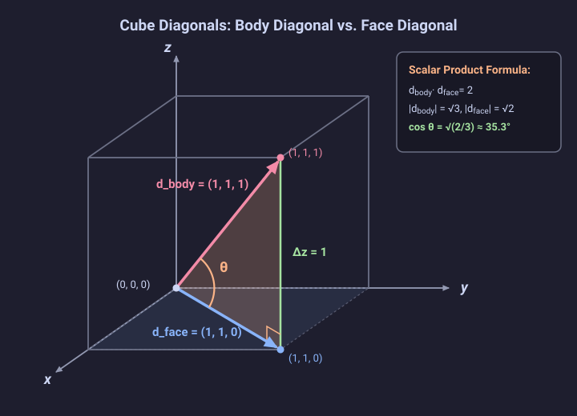

# Problem 1.5

!!! info "Textbook Reference"
    - **Textbook**: *Classical Mechanics* (John R. Taylor)
    - **Chapter**: 1 — Newton's Laws of Motion
    - **Section**: 1.2 — Space and Time
    - **Problem**: 1.5
    - **Difficulty**: $\star$
    - **Topic**: Scalar product, cube diagonals, angle between vectors

---

## Problem Statement

Find the angle between a body diagonal of a cube and any one of its face diagonals.

---

## Geometric Representation

---

## Solution

### 1. Coordinate Setup & Vector Representation

Consider a cube of unit side length with one corner located at the origin $(0, 0, 0)$ and edges aligned with the Cartesian coordinate axes.

- A body diagonal connects the origin to the opposite corner $(1, 1, 1)$:

$$
\mathbf{d}_{\text{body}} = (1, 1, 1)
$$

- A face diagonal on the bottom face ($z = 0$) connecting the origin to $(1, 1, 0)$ is:

$$
\mathbf{d}_{\text{face}} = (1, 1, 0)
$$

### 2. Magnitudes & Scalar Product

The magnitudes of each vector are:

$$
|\mathbf{d}_{\text{body}}| = \sqrt{1^2 + 1^2 + 1^2} = \sqrt{3}
$$

$$
|\mathbf{d}_{\text{face}}| = \sqrt{1^2 + 1^2 + 0^2} = \sqrt{2}
$$

Their Cartesian dot product is:

$$
\mathbf{d}_{\text{body}} \cdot \mathbf{d}_{\text{face}} = (1)(1) + (1)(1) + (1)(0) = 1 + 1 + 0 = 2
$$

### 3. Angle Between the Diagonals

Using the geometric definition of the scalar product:

$$
\mathbf{d}_{\text{body}} \cdot \mathbf{d}_{\text{face}} = |\mathbf{d}_{\text{body}}| |\mathbf{d}_{\text{face}}| \cos \theta
$$

$$
2 = \sqrt{3} \cdot \sqrt{2} \cos \theta = \sqrt{6} \cos \theta
$$

Solving for $\cos \theta$:

$$
\cos \theta = \frac{2}{\sqrt{6}} = \sqrt{\frac{2}{3}}
$$

Taking the inverse cosine:

$$
\theta = \arccos\left(\sqrt{\frac{2}{3}}\right) \approx 0.615 \text{ rad} \approx 35.3^\circ
$$
