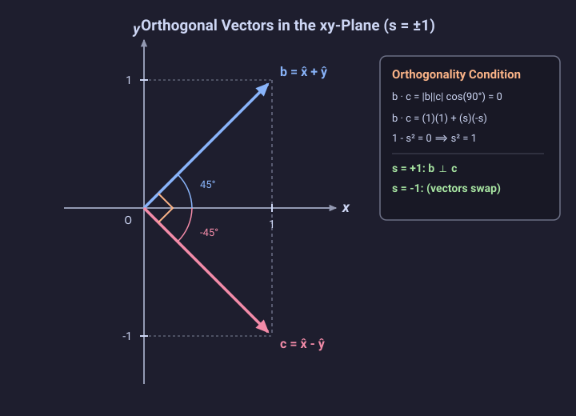

# Problem 1.6

!!! info "Textbook Reference"
    - **Textbook**: *Classical Mechanics* (John R. Taylor)
    - **Chapter**: 1 — Newton's Laws of Motion
    - **Section**: 1.2 — Space and Time
    - **Problem**: 1.6
    - **Difficulty**: $\star$
    - **Topic**: Scalar product, orthogonal vectors

---

## Problem Statement

By evaluating their dot product, find the values of the scalar $s$ for which the two vectors:

$$
\mathbf{b} = \hat{\mathbf{x}} + s\hat{\mathbf{y}} \quad \text{and} \quad \mathbf{c} = \hat{\mathbf{x}} - s\hat{\mathbf{y}}
$$

are orthogonal. Explain your answers with a sketch.

---

## Geometric Representation

---

## Solution

### 1. Dot Product Evaluation

The two given vectors in Cartesian components are:

$$
\mathbf{b} = (1, s, 0), \quad \mathbf{c} = (1, -s, 0)
$$

Evaluating their scalar product using Cartesian components:

$$
\mathbf{b} \cdot \mathbf{c} = b_x c_x + b_y c_y + b_z c_z = (1)(1) + (s)(-s) + (0)(0) = 1 - s^2
$$

### 2. Orthogonality Condition

Two non-zero vectors are orthogonal if and only if their scalar product is zero:

$$
\mathbf{b} \cdot \mathbf{c} = |\mathbf{b}||\mathbf{c}|\cos(90^\circ) = 0
$$

Setting the evaluated dot product to zero:

$$
1 - s^2 = 0 \implies s^2 = 1 \implies s = \pm 1
$$

### 3. Geometric Interpretation

- For $s = 1$, the vectors are $\mathbf{b} = \hat{\mathbf{x}} + \hat{\mathbf{y}}$ and $\mathbf{c} = \hat{\mathbf{x}} - \hat{\mathbf{y}}$. In the $xy$-plane, $\mathbf{b}$ forms an angle of $+45^\circ$ with the $x$-axis and $\mathbf{c}$ forms an angle of $-45^\circ$. The angle between them is $45^\circ - (-45^\circ) = 90^\circ$.
- For $s = -1$, the vectors exchange roles: $\mathbf{b} = \hat{\mathbf{x}} - \hat{\mathbf{y}}$ (at $-45^\circ$) and $\mathbf{c} = \hat{\mathbf{x}} + \hat{\mathbf{y}}$ (at $+45^\circ$), which remain perpendicular.

Because $\mathbf{b}$ and $\mathbf{c}$ are symmetric reflections across the $x$-axis, orthogonality requires each vector to bisect the coordinate axes at $45^\circ$, which occurs when $|s| = 1$.
