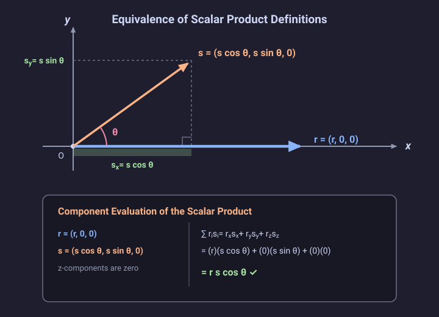

# Problem 1.7

!!! info "Textbook Reference"
    - **Textbook**: *Classical Mechanics* (John R. Taylor)
    - **Chapter**: 1 — Newton's Laws of Motion
    - **Section**: 1.2 — Space and Time
    - **Problem**: 1.7
    - **Difficulty**: $\star$
    - **Topic**: Scalar product equivalence, geometric vs component definition

---

## Problem Statement

Prove that the two definitions of the scalar product $\mathbf{r} \cdot \mathbf{s}$ as:

$$
\mathbf{r} \cdot \mathbf{s} = r s \cos \theta
$$

and:

$$
\mathbf{r} \cdot \mathbf{s} = \sum_{i} r_i s_i
$$

are equal.

---

## Geometric Representation

---

## Solution

### 1. Coordinate System Setup

Choose Cartesian coordinate axes oriented to simplify the components:

1. Align the $x$-axis along the direction of vector $\mathbf{r}$.
2. Choose the $y$-axis in the plane spanned by $\mathbf{r}$ and $\mathbf{s}$, perpendicular to the $x$-axis.
3. Choose the $z$-axis normal to this plane.

### 2. Vector Components

In this coordinate frame:

- Vector $\mathbf{r}$ has only an $x$-component:

$$
\mathbf{r} = (r, 0, 0)
$$

where $r = |\mathbf{r}|$.

- Vector $\mathbf{s}$ lies in the $xy$-plane at an angle $\theta$ relative to $\mathbf{r}$:

$$
\mathbf{s} = (s \cos \theta, s \sin \theta, 0)
$$

where $s = |\mathbf{s}|$.

### 3. Component Evaluation

Evaluating the Cartesian sum definition:

$$
\sum_{i=1}^{3} r_i s_i = r_x s_x + r_y s_y + r_z s_z
$$

Substituting the explicit components:

$$
\sum_{i=1}^{3} r_i s_i = (r)(s \cos \theta) + (0)(s \sin \theta) + (0)(0)
$$

$$
\sum_{i=1}^{3} r_i s_i = r s \cos \theta
$$

This matches the geometric definition $\mathbf{r} \cdot \mathbf{s} = r s \cos \theta$.
