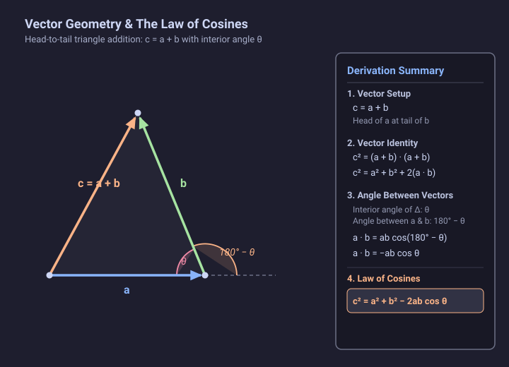

# Problem 1.9

!!! info "Textbook Reference"
    - **Textbook**: *Classical Mechanics* (John R. Taylor)
    - **Chapter**: 1 — Newton's Laws of Motion
    - **Problem**: 1.9
    - **Topic**: Vector Algebra (Law of Cosines via Scalar Product)

---

## Problem Statement

In elementary trigonometry, the law of cosines for a triangle with side lengths $a$, $b$, and $c$ states:

$$
c^2 = a^2 + b^2 - 2ab \cos\theta
$$

where $\theta$ is the interior angle between sides $a$ and $b$.

Show that the law of cosines is an immediate consequence of the vector identity:

$$
(\mathbf{a} + \mathbf{b})^2 = a^2 + b^2 + 2\mathbf{a} \cdot \mathbf{b}
$$

---

## Setup & Diagram

Consider a triangle formed by placing vectors $\mathbf{a}$ and $\mathbf{b}$ in a head-to-tail configuration:

- Vector $\mathbf{a}$ lies along the side of length $a$, with its head ending at the vertex meeting side $b$.
- Vector $\mathbf{b}$ originates at that vertex (tail of $\mathbf{b}$ at head of $\mathbf{a}$) and runs along the side of length $b$.
- The third side is the resultant vector:

$$
\mathbf{c} = \mathbf{a} + \mathbf{b}
$$

having magnitude $c = |\mathbf{c}|$.

---

## Solution

### 1. Vector Expansion

Taking the scalar product of $\mathbf{c}$ with itself:

$$
c^2 = \mathbf{c} \cdot \mathbf{c} = (\mathbf{a} + \mathbf{b}) \cdot (\mathbf{a} + \mathbf{b})
$$

Using the distributive and commutative properties of the dot product:

$$
c^2 = \mathbf{a} \cdot \mathbf{a} + \mathbf{b} \cdot \mathbf{b} + 2(\mathbf{a} \cdot \mathbf{b}) = a^2 + b^2 + 2(\mathbf{a} \cdot \mathbf{b})
$$

---

### 2. Angle Between the Vectors

By definition, the dot product between two vectors depends on the angle $\phi$ between their directions when placed tail-to-tail:

$$
\mathbf{a} \cdot \mathbf{b} = ab \cos\phi
$$

In the triangle, the interior angle at the vertex connecting side $a$ and side $b$ is $\theta$.

Because $\mathbf{a}$ enters the vertex and $\mathbf{b}$ leaves it, the direction of $\mathbf{a}$ points forward along the line of side $a$. Extending vector $\mathbf{a}$ straight through the vertex shows that the angle between the forward direction of $\mathbf{a}$ and the direction of $\mathbf{b}$ is the supplementary angle:

$$
\phi = 180^\circ - \theta
$$

---

### 3. Evaluating the Dot Product

Using the trigonometric identity $\cos(180^\circ - \theta) = -\cos\theta$:

$$
\mathbf{a} \cdot \mathbf{b} = ab \cos(180^\circ - \theta) = -ab \cos\theta
$$

Substituting this result into the vector identity yields:

$$
c^2 = a^2 + b^2 + 2(-ab \cos\theta) = a^2 + b^2 - 2ab \cos\theta
$$

which is precisely the trigonometric law of cosines.
