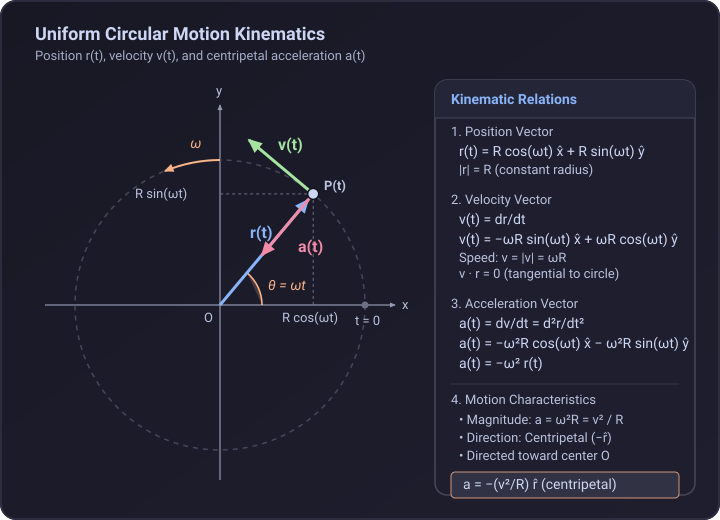

# Problem 1.10

!!! info "Textbook Reference"
    - **Textbook**: *Classical Mechanics* (John R. Taylor)
    - **Chapter**: 1 — Newton's Laws of Motion
    - **Problem**: 1.10
    - **Difficulty**: $\star$
    - **Topic**: Kinematics of Uniform Circular Motion

---

## Problem Statement

A particle moves in a circle of radius $R$ centered at the origin $O$ with constant angular velocity $\omega$ counterclockwise. The circle lies in the $xy$ plane, and the particle is located on the positive $x$-axis at $t = 0$.

1. Show that the particle's position vector is given by:

$$
\mathbf{r}(t) = \hat{\mathbf{x}} R \cos(\omega t) + \hat{\mathbf{y}} R \sin(\omega t)
$$

2. Find the particle's velocity $\mathbf{v}(t)$ and acceleration $\mathbf{a}(t)$.
3. Determine the magnitude and direction of the acceleration.
4. Relate these results to well-known properties of uniform circular motion.

---

## Geometric Representation

With constant angular velocity $\omega = \dot{\theta}$, the angle $\theta(t)$ swept counterclockwise from the positive $x$-axis satisfies:

$$
\theta(t) = \theta(0) + \int_0^t \omega \, dt' = \omega t
$$

since $\theta(0) = 0$.

---

## Solution

### 1. Position Vector $\mathbf{r}(t)$

From standard trigonometry in the Cartesian plane, the coordinates of a point at distance $R$ from the origin at angle $\theta(t)$ are:

$$
x(t) = R \cos\theta(t) = R \cos(\omega t)
$$

$$
y(t) = R \sin\theta(t) = R \sin(\omega t)
$$

Thus, the position vector is:

$$
\mathbf{r}(t) = \hat{\mathbf{x}} R \cos(\omega t) + \hat{\mathbf{y}} R \sin(\omega t)
$$

---

### 2. Velocity and Acceleration Vectors

Differentiating $\mathbf{r}(t)$ with respect to time $t$ gives the velocity:

$$
\mathbf{v}(t) = \dot{\mathbf{r}}(t) = \frac{d}{dt} \left[ \hat{\mathbf{x}} R \cos(\omega t) + \hat{\mathbf{y}} R \sin(\omega t) \right]
$$

$$
\mathbf{v}(t) = -\hat{\mathbf{x}} \omega R \sin(\omega t) + \hat{\mathbf{y}} \omega R \cos(\omega t)
$$

Differentiating velocity with respect to time gives the acceleration:

$$
\mathbf{a}(t) = \dot{\mathbf{v}}(t) = \frac{d}{dt} \left[ -\hat{\mathbf{x}} \omega R \sin(\omega t) + \hat{\mathbf{y}} \omega R \cos(\omega t) \right]
$$

$$
\mathbf{a}(t) = -\hat{\mathbf{x}} \omega^2 R \cos(\omega t) - \hat{\mathbf{y}} \omega^2 R \sin(\omega t)
$$

Factoring out $-\omega^2$:

$$
\mathbf{a}(t) = -\omega^2 \left( \hat{\mathbf{x}} R \cos(\omega t) + \hat{\mathbf{y}} R \sin(\omega t) \right) = -\omega^2 \mathbf{r}(t)
$$

---

### 3. Magnitude and Direction of Acceleration

#### Magnitude
The magnitude of $\mathbf{a}(t)$ is:

$$
a = |\mathbf{a}(t)| = \sqrt{\left(-\omega^2 R \cos(\omega t)\right)^2 + \left(-\omega^2 R \sin(\omega t)\right)^2} = \omega^2 R \sqrt{\cos^2(\omega t) + \sin^2(\omega t)} = \omega^2 R
$$

#### Direction
Since $\mathbf{a}(t) = -\omega^2 \mathbf{r}(t)$ and $\omega^2 > 0$, the acceleration vector is directly opposite to the radial position vector $\mathbf{r}(t)$. That is, it points radially inward toward the center of the circle (the origin $O$):

$$
\hat{\mathbf{a}} = -\hat{\mathbf{r}}
$$

---

### 4. Connection to Well-Known Properties of Uniform Circular Motion

1. **Centripetal Nature**: The inward radial acceleration $\mathbf{a} = -\omega^2 \mathbf{r}$ is the classical centripetal acceleration required to continuously bend the velocity vector along a circular path without changing its speed.
2. **Speed & Acceleration Formula**: The linear speed is:

$$
v = |\mathbf{v}(t)| = \omega R \sqrt{\sin^2(\omega t) + \cos^2(\omega t)} = \omega R
$$

Expressing $\omega$ as $v / R$, the magnitude of the centripetal acceleration recovers the familiar elementary relation:

$$
a = \omega^2 R = \left(\frac{v}{R}\right)^2 R = \frac{v^2}{R}
$$

3. **Orthogonality of $\mathbf{v}$ and $\mathbf{r}$**: Taking the dot product of position and velocity:

$$
\mathbf{r} \cdot \mathbf{v} = (R \cos\omega t)(-\omega R \sin\omega t) + (R \sin\omega t)(\omega R \cos\omega t) = 0
$$

This verifies that the velocity is strictly tangential to the circle at all times.
