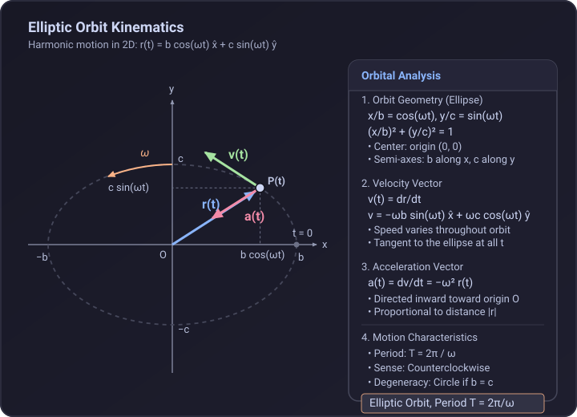

# Problem 1.11

!!! info "Textbook Reference"
    - **Textbook**: *Classical Mechanics* (John R. Taylor)
    - **Chapter**: 1 — Newton's Laws of Motion
    - **Problem**: 1.11
    - **Difficulty**: $\star$
    - **Topic**: Kinematics (Elliptic Orbits in Cartesian Coordinates)

---

## Problem Statement

The position of a moving particle is given as a function of time $t$ by:

$$
\mathbf{r}(t) = \hat{\mathbf{x}} b \cos(\omega t) + \hat{\mathbf{y}} c \sin(\omega t)
$$

where $b$, $c$, and $\omega$ are positive constants. Describe the particle's orbit.

---

## Geometric Representation

The Cartesian components of the particle's position vector $\mathbf{r}(t)$ are:

$$
x(t) = b \cos(\omega t), \quad y(t) = c \sin(\omega t)
$$

---

## Solution

### 1. Shape and Geometry of the Orbit

To determine the spatial trajectory followed by the particle, we eliminate time $t$ using the identity $\cos^2(\omega t) + \sin^2(\omega t) = 1$:

$$
\frac{x(t)}{b} = \cos(\omega t), \quad \frac{y(t)}{c} = \sin(\omega t)
$$

Squaring and adding both expressions:

$$
\left(\frac{x}{b}\right)^2 + \left(\frac{y}{c}\right)^2 = \cos^2(\omega t) + \sin^2(\omega t) = 1
$$

This is the standard equation of an **ellipse** centered at the origin $(0, 0)$:
- **Principal axes**: Aligned with the coordinate axes ($x$ and $y$).
- **Semi-axes**: Semi-axis length $b$ along the $x$-axis and semi-axis length $c$ along the $y$-axis.
- **Special Case**: If $b = c = R$, the orbit becomes a circle of radius $R$.

---

### 2. Velocity and Direction of Motion

Differentiating the position vector $\mathbf{r}(t)$ with respect to time yields the velocity:

$$
\mathbf{v}(t) = \dot{\mathbf{r}}(t) = -\hat{\mathbf{x}} b \omega \sin(\omega t) + \hat{\mathbf{y}} c \omega \cos(\omega t)
$$

Evaluating the motion at successive quarter-period positions:
- At $t = 0$:

$$
\mathbf{r}(0) = (b, 0), \quad \mathbf{v}(0) = (0, c\omega) = \hat{\mathbf{y}} c\omega
$$

The particle starts on the positive $x$-axis at $(b, 0)$ moving in the $+y$ direction.
- At $t = \frac{\pi}{2\omega}$:

$$
\mathbf{r}\left(\frac{\pi}{2\omega}\right) = (0, c), \quad \mathbf{v}\left(\frac{\pi}{2\omega}\right) = (-b\omega, 0) = -\hat{\mathbf{x}} b\omega
$$

The particle reaches $(0, c)$ on the positive $y$-axis moving in the $-x$ direction.

Therefore, the orbit is traversed in the **counterclockwise** direction.

---

### 3. Acceleration

Differentiating the velocity vector $\mathbf{v}(t)$ gives the acceleration:

$$
\mathbf{a}(t) = \dot{\mathbf{v}}(t) = -\hat{\mathbf{x}} b \omega^2 \cos(\omega t) - \hat{\mathbf{y}} c \omega^2 \sin(\omega t)
$$

Factoring out $-\omega^2$:

$$
\mathbf{a}(t) = -\omega^2 \left[ \hat{\mathbf{x}} b \cos(\omega t) + \hat{\mathbf{y}} c \sin(\omega t) \right] = -\omega^2 \mathbf{r}(t)
$$

The acceleration vector always points directly inward toward the origin, with magnitude proportional to the particle's distance from the center:

$$
|\mathbf{a}(t)| = \omega^2 |\mathbf{r}(t)|
$$

---

### 4. Periodicity

Because the functions $\cos(\omega t)$ and $\sin(\omega t)$ are periodic with fundamental period $2\pi/\omega$, the particle completes one full cycle around the ellipse in time:

$$
T = \frac{2\pi}{\omega}
$$
