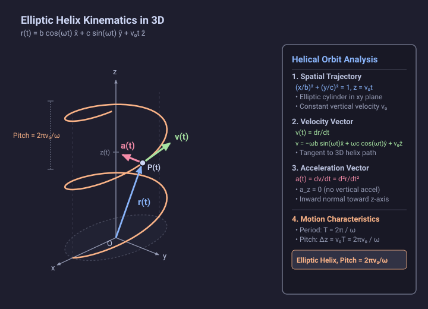

# Problem 1.12

!!! info "Textbook Reference"
    - **Textbook**: *Classical Mechanics* (John R. Taylor)
    - **Chapter**: 1 — Newton's Laws of Motion
    - **Problem**: 1.12
    - **Difficulty**: $\star$
    - **Topic**: Kinematics (Helical Trajectories in 3D Cartesian Coordinates)

---

## Problem Statement

The position of a moving particle is given as a function of time $t$ by:

$$
\mathbf{r}(t) = \hat{\mathbf{x}} b \cos(\omega t) + \hat{\mathbf{y}} c \sin(\omega t) + \hat{\mathbf{z}} v_0 t
$$

where $b$, $c$, $v_0$, and $\omega$ are positive constants. Describe the particle's orbit.

---

## Geometric Representation

The Cartesian components of the position vector $\mathbf{r}(t)$ are:

$$
x(t) = b \cos(\omega t), \quad y(t) = c \sin(\omega t), \quad z(t) = v_0 t
$$

---

## Solution

### 1. Geometric Form of the Trajectory

The motion naturally decouples into transverse motion in the $xy$ plane and uniform longitudinal motion along the $z$-axis:

1. **Projection onto the $xy$ plane**:
   Using the identity $\cos^2(\omega t) + \sin^2(\omega t) = 1$:

$$
\left(\frac{x}{b}\right)^2 + \left(\frac{y}{c}\right)^2 = \cos^2(\omega t) + \sin^2(\omega t) = 1
$$

The projection onto the $xy$ plane is a closed ellipse centered at the origin, with semi-axes $b$ and $c$ along the $x$- and $y$-axes respectively.

2. **Longitudinal motion along the $z$-axis**:

$$
z(t) = v_0 t
$$

The height $z$ increases linearly with time at a constant speed $v_0$.

Combining these two features, the particle winds around an elliptic cylinder defined by $\left(\frac{x}{b}\right)^2 + \left(\frac{y}{c}\right)^2 = 1$ while advancing steadily along its longitudinal axis ($z$). The trajectory is an **elliptic helix** (or an **oval helix**).

- If $b = c = R$, the orbit reduces to a standard circular helix wound around a cylinder of radius $R$.

---

### 2. Velocity Vector

Differentiating the position vector $\mathbf{r}(t)$ with respect to time yields the velocity:

$$
\mathbf{v}(t) = \dot{\mathbf{r}}(t) = -\hat{\mathbf{x}} b \omega \sin(\omega t) + \hat{\mathbf{y}} c \omega \cos(\omega t) + \hat{\mathbf{z}} v_0
$$

The velocity vector is everywhere tangent to the helical curve. Its magnitude (speed) is:

$$
v(t) = |\mathbf{v}(t)| = \sqrt{b^2 \omega^2 \sin^2(\omega t) + c^2 \omega^2 \cos^2(\omega t) + v_0^2}
$$

The speed fluctuates periodically between $\sqrt{c^2 \omega^2 + v_0^2}$ and $\sqrt{b^2 \omega^2 + v_0^2}$ as the particle traverses the differing curvatures of the ellipse (becoming strictly constant if $b = c$).

---

### 3. Acceleration Vector

Differentiating the velocity vector $\mathbf{v}(t)$ gives the acceleration:

$$
\mathbf{a}(t) = \dot{\mathbf{v}}(t) = -\hat{\mathbf{x}} b \omega^2 \cos(\omega t) - \hat{\mathbf{y}} c \omega^2 \sin(\omega t) + \hat{\mathbf{z}} (0)
$$

Factoring out $-\omega^2$:

$$
\mathbf{a}(t) = -\omega^2 \left[ \hat{\mathbf{x}} b \cos(\omega t) + \hat{\mathbf{y}} c \sin(\omega t) \right]
$$

- The vertical acceleration component is identically zero ($a_z = 0$) because the motion along the $z$-axis is uniform.
- In the transverse plane, the acceleration vector points directly inward toward the $z$-axis (the axis of the cylinder) at all times, with magnitude proportional to the perpendicular distance $\rho = \sqrt{x^2 + y^2}$ from the $z$-axis:

$$
|\mathbf{a}(t)| = \omega^2 \sqrt{b^2 \cos^2(\omega t) + c^2 \sin^2(\omega t)}
$$

---

### 4. Periodicity and Pitch

- **Period**: One full revolution around the cylinder in the $xy$ plane requires time:

$$
T = \frac{2\pi}{\omega}
$$

- **Sense of Rotation**: At $t = 0$, $\mathbf{r} = (b, 0, 0)$ and $\mathbf{v} = (0, c\omega, v_0)$, moving counterclockwise in the $xy$ plane while ascending in $+z$.
- **Pitch**: In one full period $T$, the distance traveled along the vertical axis is:

$$
p = \Delta z = v_0 T = \frac{2\pi v_0}{\omega}
$$

The helix advances by a constant pitch $p = 2\pi v_0 / \omega$ per revolution.
