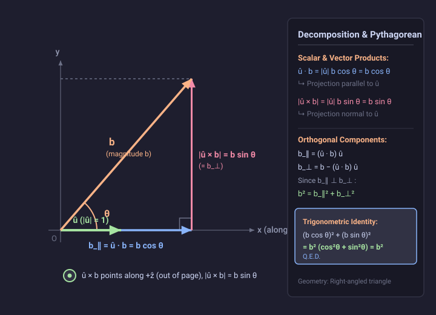

# Problem 1.13

!!! info "Textbook Reference"
    - **Textbook**: *Classical Mechanics* (John R. Taylor)
    - **Chapter**: 1 — Newton's Laws of Motion
    - **Problem**: 1.13
    - **Difficulty**: $\star$
    - **Topic**: Vector Algebra, Dot and Cross Products, Orthogonal Decomposition

---

## Problem Statement

Let $\mathbf{u}$ be an arbitrary fixed unit vector ($|\mathbf{u}| = 1$). Show that any vector $\mathbf{b}$ satisfies:

$$
b^2 = (\mathbf{u} \cdot \mathbf{b})^2 + (\mathbf{u} \times \mathbf{b})^2
$$

Explain this result in words, with the help of a picture.

---

## Geometric Representation

---

## Solution

### 1. Vector Setup & Geometric Products

Let $\theta$ denote the angle between the unit vector $\mathbf{u}$ and the vector $\mathbf{b}$, where $0 \le \theta \le \pi$.

From the definitions of the scalar (dot) product and vector (cross) product:

1. **Dot product**:

$$
\mathbf{u} \cdot \mathbf{b} = |\mathbf{u}| |\mathbf{b}| \cos\theta = b \cos\theta
$$

   Squaring both sides:

$$
(\mathbf{u} \cdot \mathbf{b})^2 = b^2 \cos^2\theta
$$

2. **Cross product magnitude**:

$$
|\mathbf{u} \times \mathbf{b}| = |\mathbf{u}| |\mathbf{b}| \sin\theta = b \sin\theta
$$

   Squaring the cross product vector gives its squared magnitude:

$$
(\mathbf{u} \times \mathbf{b})^2 = |\mathbf{u} \times \mathbf{b}|^2 = b^2 \sin^2\theta
$$

### 2. Proving the Identity

Summing the two squared quantities:

$$
(\mathbf{u} \cdot \mathbf{b})^2 + (\mathbf{u} \times \mathbf{b})^2 = b^2 \cos^2\theta + b^2 \sin^2\theta = b^2 (\cos^2\theta + \sin^2\theta)
$$

Applying the fundamental trigonometric identity $\cos^2\theta + \sin^2\theta = 1$:

$$
(\mathbf{u} \cdot \mathbf{b})^2 + (\mathbf{u} \times \mathbf{b})^2 = b^2
$$

### 3. Geometric Interpretation

Any vector $\mathbf{b}$ can be decomposed into two mutually perpendicular component vectors relative to the reference axis $\mathbf{u}$:

- A parallel component along $\mathbf{u}$:

$$
\mathbf{b}_\parallel = (\mathbf{u} \cdot \mathbf{b})\mathbf{u}, \quad \text{with magnitude } |\mathbf{b}_\parallel| = |\mathbf{u} \cdot \mathbf{b}| = b |\cos\theta|
$$

- A perpendicular component normal to $\mathbf{u}$:

$$
\mathbf{b}_\perp = \mathbf{b} - \mathbf{b}_\parallel, \quad \text{with magnitude } |\mathbf{b}_\perp| = |\mathbf{u} \times \mathbf{b}| = b \sin\theta
$$

Because $\mathbf{b}_\parallel$ and $\mathbf{b}_\perp$ form the orthogonal legs of a right-angled triangle whose hypotenuse is $\mathbf{b}$, the identity is simply a statement of the Pythagorean theorem:

$$
b^2 = |\mathbf{b}_\parallel|^2 + |\mathbf{b}_\perp|^2 = (\mathbf{u} \cdot \mathbf{b})^2 + (\mathbf{u} \times \mathbf{b})^2
$$
