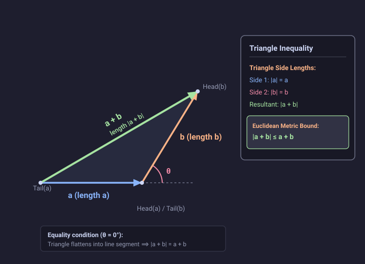

# Problem 1.14

!!! info "Textbook Reference"
    - **Textbook**: *Classical Mechanics* (John R. Taylor)
    - **Chapter**: 1 — Newton's Laws of Motion
    - **Problem**: 1.14
    - **Topic**: Triangle Inequality, Dot Product, Vector Addition

---

## Problem Statement

Prove that for any two vectors $\mathbf{a}$ and $\mathbf{b}$,

$$
|\mathbf{a} + \mathbf{b}| \le a + b
$$

[*Hint:* Work out $|\mathbf{a} + \mathbf{b}|^2$ and compare it with $(a + b)^2$.] Explain why this is called the **triangle inequality**.

---

## Proof & Explanation

### 1. Algebraic Derivation

Let $a = |\mathbf{a}|$ and $b = |\mathbf{b}|$ denote the non-negative magnitudes of the vectors $\mathbf{a}$ and $\mathbf{b}$, and let $\theta$ be the angle between them ($0 \le \theta \le \pi$).

Expanding the squared magnitude $|\mathbf{a} + \mathbf{b}|^2$ using the distributive property of the dot product:

$$
|\mathbf{a} + \mathbf{b}|^2 = (\mathbf{a} + \mathbf{b}) \cdot (\mathbf{a} + \mathbf{b}) = \mathbf{a} \cdot \mathbf{a} + 2(\mathbf{a} \cdot \mathbf{b}) + \mathbf{b} \cdot \mathbf{b}
$$

$$
|\mathbf{a} + \mathbf{b}|^2 = a^2 + b^2 + 2ab\cos\theta
$$

Now consider the square of the sum of magnitudes $(a + b)^2$:

$$
(a + b)^2 = a^2 + b^2 + 2ab
$$

Subtracting $|\mathbf{a} + \mathbf{b}|^2$ from $(a + b)^2$:

$$
(a + b)^2 - |\mathbf{a} + \mathbf{b}|^2 = 2ab(1 - \cos\theta)
$$

Since $a \ge 0$, $b \ge 0$, and the cosine function satisfies $\cos\theta \le 1$ for all real $\theta$, we have $1 - \cos\theta \ge 0$. Consequently:

$$
(a + b)^2 - |\mathbf{a} + \mathbf{b}|^2 \ge 0 \implies |\mathbf{a} + \mathbf{b}|^2 \le (a + b)^2
$$

Because both $|\mathbf{a} + \mathbf{b}|$ and $a + b$ are non-negative, taking the positive square root of both sides yields:

$$
|\mathbf{a} + \mathbf{b}| \le a + b
$$

Equality holds if and only if $2ab(1 - \cos\theta) = 0$, which occurs when $a = 0$, $b = 0$, or $\cos\theta = 1$ ($\theta = 0^\circ$, meaning $\mathbf{a}$ and $\mathbf{b}$ are collinear and point in the same direction).

### 2. Geometric Interpretation (The Triangle Inequality)

In vector geometry, the head-to-tail addition of $\mathbf{a}$ and $\mathbf{b}$ naturally constructs a triangle:
- Place the tail of $\mathbf{b}$ at the head of $\mathbf{a}$.
- The vector sum $\mathbf{a} + \mathbf{b}$ forms the third side, running directly from the tail of $\mathbf{a}$ to the head of $\mathbf{b}$.

The side lengths of this triangle are $a = |\mathbf{a}|$, $b = |\mathbf{b}|$, and $|\mathbf{a} + \mathbf{b}|$.

In Euclidean geometry, the straight-line segment connecting two points represents the shortest path between them. Moving directly along the vector $\mathbf{a} + \mathbf{b}$ has path length $|\mathbf{a} + \mathbf{b}|$, while traversing side $\mathbf{a}$ followed by side $\mathbf{b}$ has total path length $a + b$. Therefore, any side of a triangle cannot be longer than the sum of the remaining two sides:

$$
|\mathbf{a} + \mathbf{b}| \le a + b
$$

The equality condition corresponds to the degenerate triangle where all three vertices lie on a single straight line.

---

## Diagram

