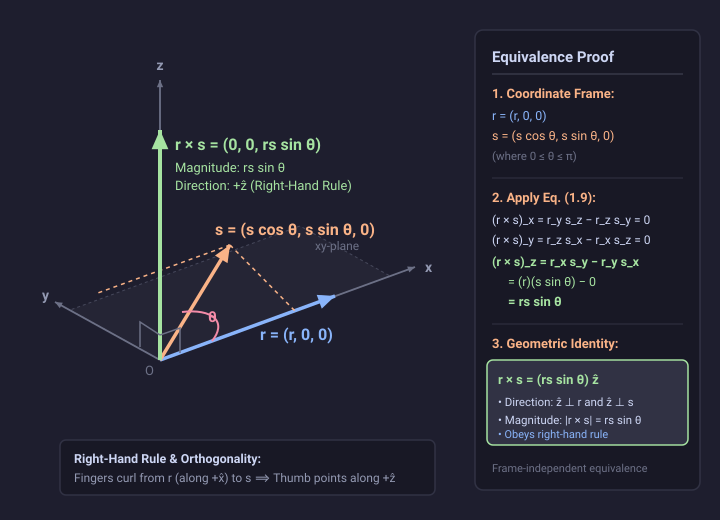

# Problem 1.15

!!! info "Textbook Reference"
    - **Textbook**: *Classical Mechanics* (John R. Taylor)
    - **Chapter**: 1 — Newton's Laws of Motion
    - **Problem**: 1.15
    - **Topic**: Cross Product, Vector Algebra, Frame Independence

---

## Problem Statement

Show that the definition (1.9) of the cross product,

$$
\mathbf{r} \times \mathbf{s} = (r_y s_z - r_z s_y)\,\hat{\mathbf{x}} + (r_z s_x - r_x s_z)\,\hat{\mathbf{y}} + (r_x s_y - r_y s_x)\,\hat{\mathbf{z}}
$$

is equivalent to the elementary definition that $\mathbf{r} \times \mathbf{s}$ is perpendicular to both $\mathbf{r}$ and $\mathbf{s}$, with magnitude $rs \sin\theta$ and direction given by the right-hand rule.

---

## Proof & Explanation

### 1. Choice of Coordinate Axes

Because definition (1.9) is independent of the orientation of the coordinate axes, we are free to choose an orthonormal, right-handed Cartesian coordinate system oriented conveniently:

1. Align the $x$-axis along $\mathbf{r}$:

$$
\mathbf{r} = (r,\, 0,\, 0)
$$

   where $r = |\mathbf{r}| \ge 0$, giving components $r_x = r$, $r_y = 0$, and $r_z = 0$.

2. Orient the $y$-axis in the plane defined by $\mathbf{r}$ and $\mathbf{s}$ such that $\mathbf{s}$ lies in the half-plane $s_y \ge 0$. Letting $\theta$ ($0 \le \theta \le \pi$) denote the angle between $\mathbf{r}$ and $\mathbf{s}$:

$$
\mathbf{s} = (s \cos\theta,\, s \sin\theta,\, 0)
$$

   where $s = |\mathbf{s}| \ge 0$, giving components $s_x = s\cos\theta$, $s_y = s\sin\theta$, and $s_z = 0$.

3. The $z$-axis completes the right-handed Cartesian triad ($\hat{\mathbf{z}} = \hat{\mathbf{x}} \times \hat{\mathbf{y}}$), pointing perpendicularly outward from the $xy$-plane.

### 2. Evaluation via Component Definition (1.9)

Substituting these components into definition (1.9):

1. **$x$-component**:

$$
(\mathbf{r} \times \mathbf{s})_x = r_y s_z - r_z s_y = (0)(0) - (0)(s \sin\theta) = 0
$$

2. **$y$-component**:

$$
(\mathbf{r} \times \mathbf{s})_y = r_z s_x - r_x s_z = (0)(s \cos\theta) - (r)(0) = 0
$$

3. **$z$-component**:

$$
(\mathbf{r} \times \mathbf{s})_z = r_x s_y - r_y s_x = (r)(s \sin\theta) - (0)(s \cos\theta) = rs \sin\theta
$$

Thus, definition (1.9) reduces to:

$$
\mathbf{r} \times \mathbf{s} = (rs \sin\theta)\,\hat{\mathbf{z}}
$$

### 3. Equivalence with the Elementary Definition

From the resulting vector $\mathbf{r} \times \mathbf{s} = (rs \sin\theta)\,\hat{\mathbf{z}}$:

- **Magnitude**: Since $0 \le \theta \le \pi$, we have $\sin\theta \ge 0$, so:

$$
|\mathbf{r} \times \mathbf{s}| = |rs \sin\theta| = rs \sin\theta
$$

- **Perpendicularity**: The vector points purely along $\hat{\mathbf{z}}$, whereas both $\mathbf{r}$ and $\mathbf{s}$ have zero $z$-components (lying entirely in the $xy$-plane). Thus:

$$
(\mathbf{r} \times \mathbf{s}) \cdot \mathbf{r} = 0, \quad (\mathbf{r} \times \mathbf{s}) \cdot \mathbf{s} = 0
$$

  demonstrating that $\mathbf{r} \times \mathbf{s}$ is orthogonal to both vectors.

- **Right-Hand Rule**: Because $\sin\theta \ge 0$, the vector is directed along $+\hat{\mathbf{z}}$. In a right-handed system, sweeping the fingers of the right hand from $\mathbf{r}$ (along $+\hat{\mathbf{x}}$) through the angle $\theta$ toward $\mathbf{s}$ in the $xy$-plane points the thumb in the $+\hat{\mathbf{z}}$ direction.

Hence, definition (1.9) is equivalent to the elementary geometric definition.

---

## Diagram

