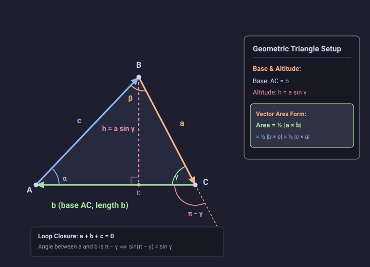

# Problem 1.18

!!! info "Textbook Reference"
    - **Textbook**: *Classical Mechanics* (John R. Taylor)
    - **Chapter**: 1 — Newton's Laws of Motion
    - **Problem**: 1.18
    - **Topic**: Cross Product, Triangle Area, Law of Sines, Loop Closure

---

## Problem Statement

The three vectors $\mathbf{a}$, $\mathbf{b}$, $\mathbf{c}$ are the three sides of the triangle $ABC$ with internal angles $\alpha, \beta, \gamma$ as shown in Figure 1.15.

**(a)** Prove that the area of the triangle is given by any one of these three expressions:

$$
\text{area} = \frac{1}{2}|\mathbf{a} \times \mathbf{b}| = \frac{1}{2}|\mathbf{b} \times \mathbf{c}| = \frac{1}{2}|\mathbf{c} \times \mathbf{a}|
$$

**(b)** Use the equality of these three expressions to prove the so-called law of sines, that

$$
\frac{a}{\sin\alpha} = \frac{b}{\sin\beta} = \frac{c}{\sin\gamma}
$$

---

## Proof & Solution

### Part (a): Area of the Triangle

Let vectors $\mathbf{a}, \mathbf{b}, \mathbf{c}$ form the sides of $\triangle ABC$ arranged head-to-tail in a closed loop:

$$
\mathbf{a} + \mathbf{b} + \mathbf{c} = \mathbf{0}
$$

where the internal angles at vertices $A, B,$ and $C$ are $\alpha, \beta,$ and $\gamma$, respectively.

#### 1. Area via Altitude Decomposition

Choose side $AC$ (length $b = |\mathbf{b}|$) as the base. Drop an altitude $BD$ perpendicular from vertex $B$ to side $AC$, with height $h$.

In the right-angled triangle $\triangle CBD$, the hypotenuse is $a = |\mathbf{a}|$ and the internal angle at vertex $C$ is $\gamma$:

$$
h = a \sin\gamma
$$

The altitude splits $\triangle ABC$ into two right triangles whose combined base length is $AD + DC = b$. The area of the triangle is therefore:

$$
\text{area} = \frac{1}{2} b h = \frac{1}{2} a b \sin\gamma
$$

#### 2. Cross Product Magnitude

At vertex $C$, vector $\mathbf{a}$ points into vertex $C$ while vector $\mathbf{b}$ points away from $C$. Placing both vectors tail-to-tail, the true angle between $\mathbf{a}$ and $\mathbf{b}$ is the exterior angle $\pi - \gamma$.

Using the identity $\sin(\pi - \gamma) = \sin\gamma$, the magnitude of their cross product is:

$$
|\mathbf{a} \times \mathbf{b}| = a b \sin(\pi - \gamma) = a b \sin\gamma
$$

Therefore:

$$
\text{area} = \frac{1}{2} |\mathbf{a} \times \mathbf{b}|
$$

#### 3. Equality via Loop Closure

From the loop closure condition $\mathbf{a} + \mathbf{b} + \mathbf{c} = \mathbf{0}$, take the vector cross product with $\mathbf{a}$:

$$
\mathbf{a} \times (\mathbf{a} + \mathbf{b} + \mathbf{c}) = \mathbf{0} \implies \mathbf{a} \times \mathbf{b} + \mathbf{a} \times \mathbf{c} = \mathbf{0} \implies \mathbf{a} \times \mathbf{b} = \mathbf{c} \times \mathbf{a}
$$

Similarly, taking the cross product with $\mathbf{b}$:

$$
\mathbf{b} \times (\mathbf{a} + \mathbf{b} + \mathbf{c}) = \mathbf{0} \implies \mathbf{b} \times \mathbf{a} + \mathbf{b} \times \mathbf{c} = \mathbf{0} \implies \mathbf{b} \times \mathbf{c} = \mathbf{a} \times \mathbf{b}
$$

Hence, all three cross products are identically equal:

$$
\mathbf{a} \times \mathbf{b} = \mathbf{b} \times \mathbf{c} = \mathbf{c} \times \mathbf{a}
$$

Taking magnitudes and multiplying by $1/2$ establishes:

$$
\text{area} = \frac{1}{2}|\mathbf{a} \times \mathbf{b}| = \frac{1}{2}|\mathbf{b} \times \mathbf{c}| = \frac{1}{2}|\mathbf{c} \times \mathbf{a}|
$$

---

### Part (b): The Law of Sines

In an analogous manner to vertex $C$, the tail-to-tail angle between $\mathbf{b}$ and $\mathbf{c}$ is the exterior angle $\pi - \alpha$, and between $\mathbf{c}$ and $\mathbf{a}$ is $\pi - \beta$.

Evaluating the magnitudes of the cross products using $\sin(\pi - \theta) = \sin\theta$:

$$
|\mathbf{a} \times \mathbf{b}| = a b \sin\gamma, \quad |\mathbf{b} \times \mathbf{c}| = b c \sin\alpha, \quad |\mathbf{c} \times \mathbf{a}| = c a \sin\beta
$$

Since the three cross product vectors are identical, their magnitudes are equal:

$$
a b \sin\gamma = b c \sin\alpha = c a \sin\beta
$$

Dividing each term by the non-zero product $a b c$:

$$
\frac{a b \sin\gamma}{a b c} = \frac{b c \sin\alpha}{a b c} = \frac{c a \sin\beta}{a b c}
$$

Cancelling common factors:

$$
\frac{\sin\gamma}{c} = \frac{\sin\alpha}{a} = \frac{\sin\beta}{b}
$$

Inverting each ratio gives the Law of Sines:

$$
\frac{a}{\sin\alpha} = \frac{b}{\sin\beta} = \frac{c}{\sin\gamma}
$$

---

## Diagram

