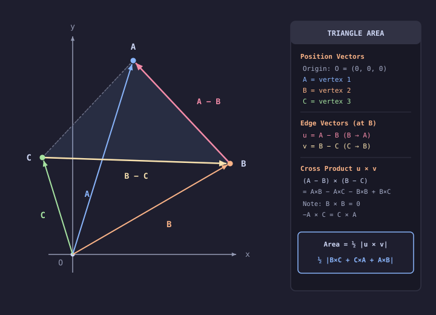

# Problem 1.20

!!! info "Textbook Reference"
    - **Textbook**: *Classical Mechanics* (John R. Taylor)
    - **Chapter**: 1 — Newton's Laws of Motion
    - **Problem**: 1.20
    - **Difficulty**: $\star\star$
    - **Topic**: Vector Geometry, Triangle Area from Position Vectors

---

## Problem Statement

The three vectors $\mathbf{A}$, $\mathbf{B}$, and $\mathbf{C}$ point from the origin $O$ to the three corners of a triangle. Use the result of Problem 1.18 to show that the area of the triangle is given by:

$$
\text{area of triangle} = \frac{1}{2} \big| (\mathbf{B} \times \mathbf{C}) + (\mathbf{C} \times \mathbf{A}) + (\mathbf{A} \times \mathbf{B}) \big|
$$

---

## Setup & Diagram

---

## Solution

From Problem 1.18, the area of a triangle formed by two adjacent side vectors sharing a common vertex (here choosing vertex $B$) is:

$$
\text{Area} = \frac{1}{2} \big| (\mathbf{A} - \mathbf{B}) \times (\mathbf{B} - \mathbf{C}) \big|
$$

Expanding the cross product using distributivity:

$$
(\mathbf{A} - \mathbf{B}) \times (\mathbf{B} - \mathbf{C}) = \mathbf{A} \times \mathbf{B} - \mathbf{A} \times \mathbf{C} - \mathbf{B} \times \mathbf{B} + \mathbf{B} \times \mathbf{C}
$$

Since any self-cross product vanishes ($\mathbf{B} \times \mathbf{B} = \mathbf{0}$) and $-\mathbf{A} \times \mathbf{C} = \mathbf{C} \times \mathbf{A}$, this simplifies directly to:

$$
(\mathbf{A} - \mathbf{B}) \times (\mathbf{B} - \mathbf{C}) = (\mathbf{B} \times \mathbf{C}) + (\mathbf{C} \times \mathbf{A}) + (\mathbf{A} \times \mathbf{B})
$$

Taking half the magnitude yields:

$$
\text{Area} = \frac{1}{2} \big| (\mathbf{B} \times \mathbf{C}) + (\mathbf{C} \times \mathbf{A}) + (\mathbf{A} \times \mathbf{B}) \big|
$$
