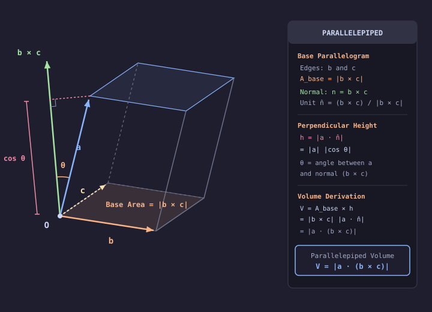

# Problem 1.21

!!! info "Textbook Reference"
    - **Textbook**: *Classical Mechanics* (John R. Taylor)
    - **Chapter**: 1 — Newton's Laws of Motion
    - **Problem**: 1.21
    - **Difficulty**: $\star\star$
    - **Topic**: Scalar Triple Product, Parallelepiped Volume

---

## Problem Statement

A parallelepiped (a six-faced solid with opposite faces parallel) has one corner at the origin $O$ and the three edges that emanate from $O$ defined by vectors $\mathbf{a}$, $\mathbf{b}$, and $\mathbf{c}$. Show that the volume of the parallelepiped is:

$$
\text{Volume} = |\mathbf{a} \cdot (\mathbf{b} \times \mathbf{c})|
$$

---

## Setup & Diagram

---

## Solution

The volume of any parallelepiped is given by the product of its base area and its perpendicular height:

$$
\text{Volume} = A_{\text{base}} \, h
$$

### 1. Base Area

Choose the face spanned by the edge vectors $\mathbf{b}$ and $\mathbf{c}$ as the base. The area of the parallelogram formed by these two vectors is given by the magnitude of their cross product:

$$
A_{\text{base}} = |\mathbf{b} \times \mathbf{c}|
$$

### 2. Perpendicular Height

The vector $\mathbf{b} \times \mathbf{c}$ is perpendicular to the plane of the base. The unit normal vector pointing perpendicular to this base is:

$$
\hat{\mathbf{n}} = \frac{\mathbf{b} \times \mathbf{c}}{|\mathbf{b} \times \mathbf{c}|}
$$

The perpendicular height $h$ is the length of the projection of the third edge vector $\mathbf{a}$ onto the normal direction $\hat{\mathbf{n}}$:

$$
h = |\mathbf{a} \cdot \hat{\mathbf{n}}| = |\mathbf{a}| |\cos \theta|
$$

where $\theta$ is the angle between $\mathbf{a}$ and the normal vector $\mathbf{b} \times \mathbf{c}$.

### 3. Volume Evaluation

Multiplying the base area by the perpendicular height:

$$
\text{Volume} = A_{\text{base}} \, h = |\mathbf{b} \times \mathbf{c}| \left| \mathbf{a} \cdot \frac{\mathbf{b} \times \mathbf{c}}{|\mathbf{b} \times \mathbf{c}|} \right|
$$

The scalar factor $|\mathbf{b} \times \mathbf{c}|$ cancels directly between numerator and denominator:

$$
\text{Volume} = |\mathbf{a} \cdot (\mathbf{b} \times \mathbf{c})|
$$
