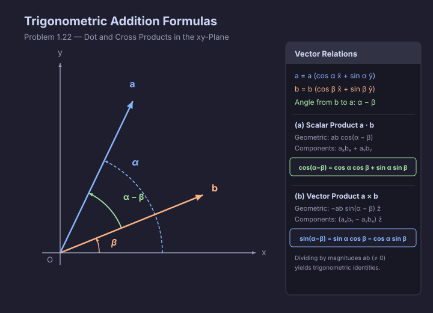

# Problem 1.22

!!! info "Textbook Reference"
    - **Textbook**: *Classical Mechanics* (John R. Taylor)
    - **Chapter**: 1 — Newton's Laws of Motion
    - **Problem**: 1.22
    - **Difficulty**: $\star\star$
    - **Topic**: Dot and Cross Products, Trigonometric Addition Formulas

## Problem Statement

The two vectors $\mathbf{a}$ and $\mathbf{b}$ lie in the $xy$ plane and make angles $\alpha$ and $\beta$ with the $x$-axis.

**(a)** By evaluating $\mathbf{a} \cdot \mathbf{b}$ in two ways [namely using (1.6) and (1.7)], prove the well-known trig identity

$$
\cos(\alpha - \beta) = \cos\alpha \cos\beta + \sin\alpha \sin\beta.
$$

**(b)** By similarly evaluating $\mathbf{a} \times \mathbf{b}$, prove that

$$
\sin(\alpha - \beta) = \sin\alpha \cos\beta - \cos\alpha \sin\beta.
$$

## Vector Setup

Let $\mathbf{a}$ and $\mathbf{b}$ be vectors in the $xy$ plane making polar angles $\alpha$ and $\beta$ with the positive $x$-axis, respectively. In Cartesian components:

$$
\mathbf{a} = a \cos\alpha\,\hat{\mathbf{x}} + a \sin\alpha\,\hat{\mathbf{y}}
$$

$$
\mathbf{b} = b \cos\beta\,\hat{\mathbf{x}} + b \sin\beta\,\hat{\mathbf{y}}
$$

where $a = |\mathbf{a}|$ and $b = |\mathbf{b}|$ are the vector magnitudes.

The directed angle from $\mathbf{b}$ to $\mathbf{a}$ is $\theta = \alpha - \beta$.

## Diagram

## Solution

### Part (a) Scalar Product & Cosine Identity

From the geometric definition of the dot product (Taylor Eq. 1.6), the scalar product is given by the product of the magnitudes and the cosine of the angle between them:

$$
\mathbf{a} \cdot \mathbf{b} = a b \cos(\alpha - \beta)
$$

From the Cartesian component definition (Taylor Eq. 1.7):

$$
\mathbf{a} \cdot \mathbf{b} = a_x b_x + a_y b_y
$$

Substituting the Cartesian components:

$$
\mathbf{a} \cdot \mathbf{b} = (a \cos\alpha)(b \cos\beta) + (a \sin\alpha)(b \sin\beta) = a b (\cos\alpha \cos\beta + \sin\alpha \sin\beta)
$$

Equating the two expressions for $\mathbf{a} \cdot \mathbf{b}$:

$$
a b \cos(\alpha - \beta) = a b (\cos\alpha \cos\beta + \sin\alpha \sin\beta)
$$

Dividing both sides by the non-zero product of magnitudes $a b$:

$$
\cos(\alpha - \beta) = \cos\alpha \cos\beta + \sin\alpha \sin\beta
$$

### Part (b) Vector Product & Sine Identity

From the geometric definition of the cross product, $\mathbf{a} \times \mathbf{b}$ is directed perpendicular to the $xy$ plane along $\hat{\mathbf{z}}$. The directed angle from $\mathbf{a}$ to $\mathbf{b}$ is $\beta - \alpha = -(\alpha - \beta)$. By the right-hand rule:

$$
\mathbf{a} \times \mathbf{b} = a b \sin(\beta - \alpha)\,\hat{\mathbf{z}} = -a b \sin(\alpha - \beta)\,\hat{\mathbf{z}}
$$

In Cartesian components, the vector cross product in the $xy$ plane has only a $z$-component:

$$
\mathbf{a} \times \mathbf{b} = (a_x b_y - a_y b_x)\,\hat{\mathbf{z}}
$$

Substituting the Cartesian components:

$$
a_x b_y - a_y b_x = (a \cos\alpha)(b \sin\beta) - (a \sin\alpha)(b \cos\beta) = a b (\cos\alpha \sin\beta - \sin\alpha \cos\beta)
$$

Factoring out a negative sign:

$$
\mathbf{a} \times \mathbf{b} = -a b (\sin\alpha \cos\beta - \cos\alpha \sin\beta)\,\hat{\mathbf{z}}
$$

Equating the two expressions for the $z$-component:

$$
-a b \sin(\alpha - \beta) = -a b (\sin\alpha \cos\beta - \cos\alpha \sin\beta)
$$

Dividing both sides by $-a b$:

$$
\sin(\alpha - \beta) = \sin\alpha \cos\beta - \cos\alpha \sin\beta
$$
