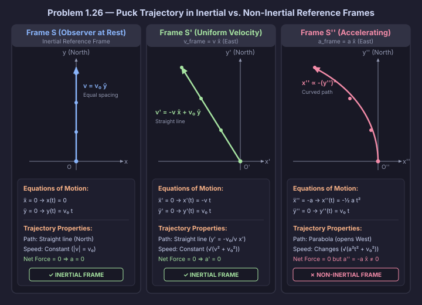

# Problem 1.26

!!! info "Textbook Reference"
    - **Textbook**: *Classical Mechanics* (John R. Taylor)
    - **Chapter**: 1 — Newton's Laws of Motion
    - **Problem**: 1.26
    - **Difficulty**: $\star\star$
    - **Topic**: Inertial vs. Non-Inertial Reference Frames

## Problem Statement

The hallmark of an inertial reference frame is that any object which is subject to zero net force travels in a straight line at constant speed. To illustrate this, consider the following:

An observer stands on a level floor at the origin of an inertial frame $\mathcal{S}$ and kicks a frictionless puck due north across the floor with initial speed $v_0$. Take the $x$-axis pointing east and the $y$-axis pointing north.

Now consider two more observers:
- The first is at rest in a frame $\mathcal{S}'$ that travels with constant velocity $v$ due east relative to $\mathcal{S}$.
- The second is at rest in a frame $\mathcal{S}''$ that travels with constant acceleration $a$ due east relative to $\mathcal{S}$.

All three frames coincide at $t = 0$ when the puck is kicked, and $\mathcal{S}''$ is initially at rest relative to $\mathcal{S}$ at that moment.

1. Write down the $x$ and $y$ coordinates of the puck as functions of time as seen from frame $\mathcal{S}$.
2. Find the coordinates $x', y'$ of the puck and describe the puck's path as seen from $\mathcal{S}'$.
3. Do the same for $\mathcal{S}''$. Which of the frames is inertial?

## Trajectory Comparison

## Solution

Let unit vectors $\hat{\mathbf{x}}$ and $\hat{\mathbf{y}}$ point east and north, respectively. At $t = 0$, all three frames share the origin $\mathbf{r}(0) = \mathbf{0}$, and the puck is launched with initial velocity:

$$
\mathbf{v}_0 = v_0 \hat{\mathbf{y}}
$$

### Part (a): Frame $\mathcal{S}$ (Observer at Rest)

Because the floor is frictionless and no net horizontal force acts on the puck ($\mathbf{F}_\text{net} = \mathbf{0}$), Newton's second law in the inertial frame $\mathcal{S}$ gives:

$$
\ddot{\mathbf{r}}(t) = \mathbf{0}
$$

Integrating once with respect to $t$:

$$
\dot{\mathbf{r}}(t) = \mathbf{C}_1
$$

Applying the initial velocity $\dot{\mathbf{r}}(0) = v_0 \hat{\mathbf{y}}$:

$$
\mathbf{C}_1 = v_0 \hat{\mathbf{y}} \implies \dot{\mathbf{r}}(t) = v_0 \hat{\mathbf{y}}
$$

Integrating a second time:

$$
\mathbf{r}(t) = v_0 t \hat{\mathbf{y}} + \mathbf{C}_2
$$

Applying the initial position $\mathbf{r}(0) = \mathbf{0}$:

$$
\mathbf{C}_2 = \mathbf{0} \implies \mathbf{r}(t) = v_0 t \hat{\mathbf{y}}
$$

Expressed in components:

$$
x(t) = 0, \quad y(t) = v_0 t
$$

The puck travels in a straight line due north at constant speed $v_0$. Because $\ddot{\mathbf{r}} = \mathbf{0}$ when no force acts, **Frame $\mathcal{S}$ is an inertial frame**.

### Part (b): Frame $\mathcal{S}'$ (Uniform Velocity Relative to $\mathcal{S}$)

Frame $\mathcal{S}'$ moves at constant velocity $\mathbf{V} = v \hat{\mathbf{x}}$ relative to $\mathcal{S}$. Its acceleration vanishes ($\ddot{\mathbf{R}}' = \mathbf{0}$), so the puck's apparent acceleration in $\mathcal{S}'$ is:

$$
\ddot{\mathbf{r}}'(t) = \ddot{\mathbf{r}}(t) - \ddot{\mathbf{R}}'(t) = \mathbf{0}
$$

Integrating once:

$$
\dot{\mathbf{r}}'(t) = \mathbf{C}'_1
$$

At $t = 0$, the puck's velocity relative to $\mathcal{S}'$ is:

$$
\dot{\mathbf{r}}'(0) = \dot{\mathbf{r}}(0) - \mathbf{V} = -v \hat{\mathbf{x}} + v_0 \hat{\mathbf{y}}
$$

Hence:

$$
\dot{\mathbf{r}}'(t) = -v \hat{\mathbf{x}} + v_0 \hat{\mathbf{y}}
$$

Integrating a second time:

$$
\mathbf{r}'(t) = (-v t \hat{\mathbf{x}} + v_0 t \hat{\mathbf{y}}) + \mathbf{C}'_2
$$

Since frames $\mathcal{S}$ and $\mathcal{S}'$ coincide at $t = 0$, $\mathbf{r}'(0) = \mathbf{0} \implies \mathbf{C}'_2 = \mathbf{0}$:

$$
\mathbf{r}'(t) = -v t \hat{\mathbf{x}} + v_0 t \hat{\mathbf{y}}
$$

In components:

$$
x'(t) = -vt, \quad y'(t) = v_0 t
$$

Eliminating time via $t = y' / v_0$:

$$
x' = -\frac{v}{v_0} y' \quad \Longleftrightarrow \quad y' = -\frac{v_0}{v} x' \quad (x' \le 0,\; y' \ge 0)
$$

The trajectory is a straight line through the origin entering the second quadrant (northwest). The speed is:

$$
|\mathbf{v}'| = \sqrt{(-v)^2 + v_0^2} = \sqrt{v^2 + v_0^2} = \text{constant}
$$

Because the zero-force object travels in a straight line at constant speed ($\ddot{\mathbf{r}}' = \mathbf{0}$), **Frame $\mathcal{S}'$ is an inertial frame**.

### Part (c): Frame $\mathcal{S}''$ (Constant Acceleration Relative to $\mathcal{S}$)

Frame $\mathcal{S}''$ accelerates at constant rate $\mathbf{A} = a \hat{\mathbf{x}}$ relative to $\mathcal{S}$. Its acceleration is $\ddot{\mathbf{R}}'' = a \hat{\mathbf{x}}$, so the puck's apparent acceleration in $\mathcal{S}''$ is:

$$
\ddot{\mathbf{r}}''(t) = \ddot{\mathbf{r}}(t) - \ddot{\mathbf{R}}''(t) = -a \hat{\mathbf{x}}
$$

Integrating once:

$$
\dot{\mathbf{r}}''(t) = -at \hat{\mathbf{x}} + \mathbf{C}''_1
$$

Since $\mathcal{S}''$ is initially at rest relative to $\mathcal{S}$ ($\dot{\mathbf{R}}''(0) = \mathbf{0}$), the initial velocity in $\mathcal{S}''$ is $\dot{\mathbf{r}}''(0) = \dot{\mathbf{r}}(0) = v_0 \hat{\mathbf{y}}$:

$$
\mathbf{C}''_1 = v_0 \hat{\mathbf{y}} \implies \dot{\mathbf{r}}''(t) = -at \hat{\mathbf{x}} + v_0 \hat{\mathbf{y}}
$$

Integrating a second time:

$$
\mathbf{r}''(t) = \left(-\frac{1}{2} a t^2 \hat{\mathbf{x}} + v_0 t \hat{\mathbf{y}}\right) + \mathbf{C}''_2
$$

Because the frames coincide at $t = 0$, $\mathbf{r}''(0) = \mathbf{0} \implies \mathbf{C}''_2 = \mathbf{0}$:

$$
\mathbf{r}''(t) = -\frac{1}{2} a t^2 \hat{\mathbf{x}} + v_0 t \hat{\mathbf{y}}
$$

In components:

$$
x''(t) = -\frac{1}{2} a t^2, \quad y''(t) = v_0 t
$$

Eliminating time via $t = y'' / v_0$:

$$
x'' = -\frac{a}{2v_0^2} (y'')^2 \quad (y'' \ge 0)
$$

The path is a **parabola** opening westward (toward negative $x''$). The puck's speed:

$$
|\mathbf{v}''(t)| = \sqrt{a^2 t^2 + v_0^2}
$$

increases continuously with time.

### Classification of Frames

- **Frames $\mathcal{S}$ and $\mathcal{S}'$ are inertial**: In both frames, the object subject to zero net force travels in a straight line at constant speed ($\ddot{\mathbf{r}} = \mathbf{0}$ and $\ddot{\mathbf{r}}' = \mathbf{0}$).
- **Frame $\mathcal{S}''$ is non-inertial**: In this frame, the puck accelerates westward ($\ddot{\mathbf{r}}'' = -a \hat{\mathbf{x}} \ne \mathbf{0}$) along a curved trajectory despite the absence of any physical force.
